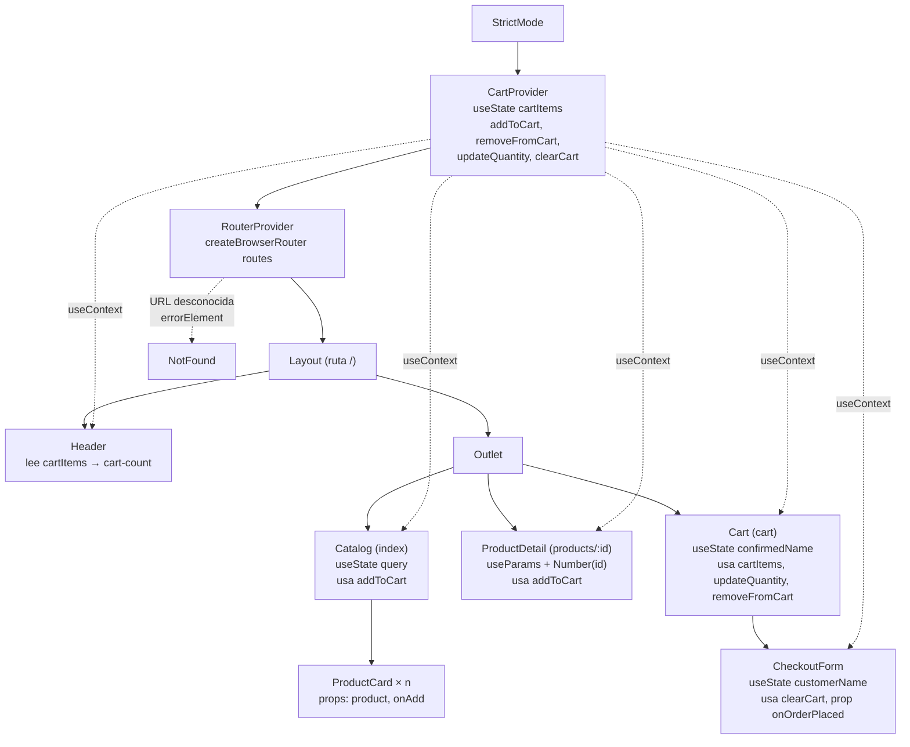

# Resumen general — Ejercicio 04: React Mini Shop

Documento de la Fase 3: une el trabajo de la Persona A y la Persona B y sirve de guion para la exposición.
Los detalles de cada parte están en [RESUMEN_PERSONA_A.md](./RESUMEN_PERSONA_A.md) y [RESUMEN_PERSONA_B.md](./RESUMEN_PERSONA_B.md).

## 1. Visión global

**Mini Shop** es una SPA (Single Page Application) de una tienda pequeña hecha con React + Vite.
No hay backend: los cuatro productos están en `src/data/products.js`. El usuario puede:

- Ver el catálogo, buscar productos por nombre y añadirlos al carrito.
- Abrir la página de detalle de cada producto (también escribiendo la URL directamente).
- Gestionar el carrito: subir y bajar cantidades, quitar productos y ver el total.
- Hacer el pedido con su nombre y ver la confirmación.
- Ver una página 404 si escribe una URL que no existe.

Lo que demuestra del temario del Módulo 04:

| Bloque | Qué se ve en el proyecto |
|---|---|
| Componentes, props y JSX | `Layout`, `Header`, `ProductCard` (props `product`, `onAdd`), `CheckoutForm` (prop `onOrderPlaced`) |
| Renderizado condicional y listas con `key` | `no-results`, `product-not-found`, `cart-empty`, `order-confirmation`; `map` en `Catalog` y `Cart` |
| `useState` inmutable | carrito con `map` + spread, `concat` y `filter` (nunca `push`) |
| Componentes controlados y formularios | buscador (`search`) y checkout (`customer-name` + `preventDefault`) |
| React Router | `createBrowserRouter`, `RouterProvider`, `Link`, `Outlet`, `useParams`, `errorElement` |
| Context API | `CartContext` + `CartProvider`, consumido con `useContext` en 5 componentes |

## 2. Árbol de componentes y flujo de datos

- Flechas continuas: quién pinta a quién (árbol de componentes).
- Flechas discontinuas desde `CartProvider`: quién lee el carrito con `useContext` (sin props).
- Las únicas **props** del proyecto van de padre a hijo directo: `Catalog → ProductCard` y `Cart → CheckoutForm`.

## 3. Recorrido de un clic: "Add to Cart"

1. El usuario pulsa **Add to Cart** en la tarjeta del Mouse (`add-2`).
2. `ProductCard` ejecuta su prop `onAdd`, que en `Catalog` es `() => addToCart(product)`.
3. `addToCart` vive en `CartProvider` (lo obtuvo `Catalog` con `useContext`). Comprueba con `find` si el Mouse ya está:
   - Si no está → `setCartItems(cartItems.concat({ id, name, price, quantity: 1 }))`.
   - Si ya está → `setCartItems(cartItems.map(...))` con una copia de esa fila con `quantity + 1`.
4. Ese `setCartItems` recibe un **array nuevo**. React compara con el anterior, ve que ha cambiado y vuelve a pintar
   el `CartProvider` y todos los componentes que leen el contexto.
5. **Header** se vuelve a pintar: el `reduce` suma las cantidades y `cart-count` pasa de 0 a 1.
6. Si el usuario va a `/cart` con `<Link>` (sin recargar), **Cart** lee el mismo `cartItems` y pinta la fila
   `cart-item-2` con `quantity-2` = 1 y el total con `formatPrice`.

Como el `CartProvider` está **por encima del router**, cambiar de página no lo desmonta y el carrito se conserva.

## 4. Cómo encajan las dos partes

Las dos personas trabajaron en paralelo gracias a la **Fase 0 (esqueleto)** y a un **contrato congelado**
(`CLAUDE.md`, sección 3):

| Pieza del contrato | La define | La usa A | La usa B |
|---|---|---|---|
| `products.js` (`id` número, `price` número) | Fase 0 | Catalog, ProductDetail | (recibe el producto en `addToCart`) |
| `formatPrice(value)` → `"$25.50"` | Fase 0 | `price-{id}`, `product-price` | `cart-total`, subtotales |
| `routes.jsx` + `main.jsx` | Fase 0 | Layout, páginas | Cart |
| `CartContext`: `cartItems`, `addToCart`, `removeFromCart`, `updateQuantity`, `clearCart` | B (stub en Fase 0) | Header (`cartItems`), Catalog y ProductDetail (`addToCart`) | Cart, CheckoutForm |
| Reglas de `data-testid` | Contrato | Header, Catalog, ProductDetail, NotFound | Cart, CheckoutForm |

- La Persona A **consume** el contexto sin saber cómo está implementado: solo conoce la interfaz.
- La Persona B **implementa** el contexto sin saber qué páginas lo usan.
- No comparten ningún archivo, así que las dos ramas se pudieron integrar sin conflictos.
- La integración (checklist 11.3) pasó a la primera: añadir el Mouse desde el catálogo y desde el detalle da una
  sola fila con cantidad 2, y 2 Mouse + 1 Laptop dan `cart-count` = 3 y `cart-total` = `$1050.99`.

## 5. Mapa temario (Módulo 04) → código

| Diapositiva | Dónde se usa (archivo) | Quién |
|---|---|---|
| Getting started con Vite / `.nvmrc` | proyecto `exercises/04`, `.nvmrc` (`v24.11.0`) | Fase 0 |
| StrictMode | `src/main.jsx` | Fase 0 |
| Componentes y props | `Layout.jsx`, `Header.jsx`, `ProductCard.jsx` (`product`, `onAdd`), `CheckoutForm.jsx` (`onOrderPlaced`) | A / B |
| JSX: `className`, cerrar etiquetas | todos los componentes | A / B |
| Renderizado condicional | `Catalog.jsx` (`no-results`), `ProductDetail.jsx` (`product-not-found`), `Cart.jsx` (`cart-empty`, `order-confirmation`), `CheckoutForm.jsx` (error) | A / B |
| Listas con `map` y `key` | `Catalog.jsx` (`key={product.id}`), `Cart.jsx` (`key={item.id}`) | A / B |
| `useState` | `Catalog.jsx` (`query`), `CartContext.jsx` (`cartItems`), `Cart.jsx` (`confirmedName`), `CheckoutForm.jsx` (`customerName`, `error`) | A / B |
| Never mutate state / spread / `concat` / `filter` | `CartContext.jsx`: `addToCart`, `updateQuantity`, `removeFromCart` | B |
| Valores derivados (no estado redundante) | `filteredProducts` (`Catalog`), `totalUnits` (`Header`), `total` (`Cart`) | A / B |
| Lifting state up | `confirmedName` en `Cart.jsx`, `onOrderPlaced` en `CheckoutForm.jsx` | B |
| Controlled components / forms / `preventDefault` | `Catalog.jsx` (`search`), `CheckoutForm.jsx` (`customer-name` + `onSubmit`) | A / B |
| React Router: `createBrowserRouter`, `RouterProvider` | `src/routes.jsx`, `src/main.jsx` | Fase 0 |
| `Link` | `Header.jsx`, `ProductCard.jsx`, `ProductDetail.jsx`, `NotFound.jsx`, `Cart.jsx` | A / B |
| Nested routes + `Outlet` | `Layout.jsx` | A |
| Dynamic segments + `useParams` | `ProductDetail.jsx` | A |
| Handling bad URLs (`errorElement`) | `routes.jsx` + `NotFound.jsx` | Fase 0 / A |
| Context API: `createContext`, `Provider` | `CartContext.jsx` | B |
| Context API: `useContext` | `Header.jsx`, `Catalog.jsx`, `ProductDetail.jsx`, `Cart.jsx`, `CheckoutForm.jsx` | A / B |

## 6. Guion de exposición (8-10 min)

| # | Tiempo | Quién | Qué contar | Qué enseñar |
|---|---|---|---|---|
| 1 | 1 min | **A** | Qué es Mini Shop, qué demuestra del temario y cómo nos repartimos el trabajo (A: navegación y páginas; B: estado global y carrito; contrato común). | Diagrama de la sección 2. |
| 2 | 2 min | **A** | **Routing**: `routes.jsx` como array, `createBrowserRouter` + `RouterProvider`. `Layout` con `<Outlet />` para no repetir el Header. `useParams` en el detalle y por qué hace falta `Number(id)`. `errorElement` → `NotFound` (sin Header, por eso lleva su enlace). `<Link>` frente a `<a>`. | `routes.jsx`, `Layout.jsx`, `ProductDetail.jsx`; abrir `/products/999` y `/loquesea`. |
| 3 | 1-2 min | **A** | **Catálogo**: `map` con `key={product.id}`, `ProductCard` con props, buscador **controlado** (`value` + `onChange`) y filtrado calculado en el render (no es estado). Arrow function en `onAdd`. | `Catalog.jsx`; buscar `LAP` y `zzz`. |
| 4 | 2 min | **B** | **Context**: problema del *prop drilling*, `createContext`, `CartContext.Provider value={...}` y `useContext`. Por qué el Provider envuelve al router (el carrito sobrevive a la navegación). | `CartContext.jsx`, `main.jsx`; `Header.jsx` leyendo `cartItems`. |
| 5 | 1-2 min | **B** | **Carrito inmutable**: `map` + spread para sumar cantidad, `concat` para añadir, `filter` para quitar, `updateQuantity` ≤ 0 elimina. Total con `reduce`. StrictMode y por qué mutar haría subir de 2 en 2. | `CartContext.jsx`, `Cart.jsx`. |
| 6 | 1 min | **B** | **Checkout**: formulario controlado, `e.preventDefault()`, `trim()`, y `confirmedName` elevado a `Cart` para que la confirmación siga visible con el carrito vacío. | `CheckoutForm.jsx`, `Cart.jsx`. |
| 7 | 2 min | **A + B** | **Demo en vivo** (checklist 11.3): A añade el Mouse desde el catálogo y desde el detalle → una fila con cantidad 2; añade un Laptop → contador 3. B va al carrito → total `$1050.99`, `+`/`−` hasta quitar una fila, checkout vacío (no pasa nada) y con "Ada" → confirmación. A cierra con `/products/999` y `/loquesea`. | La app en `npm run dev`. |

Consejo: tener abiertos de antemano `routes.jsx`, `Layout.jsx`, `Catalog.jsx`, `ProductDetail.jsx`, `CartContext.jsx`,
`Cart.jsx` y `CheckoutForm.jsx`, y la app con el carrito vacío.

## 7. Preguntas probables

### Persona A (navegación y páginas)

- **¿Qué diferencia hay entre `<Link>` y `<a>`?** `<a>` recarga la página entera y se pierde el estado en memoria
  (el carrito). `<Link>` cambia la URL sin recargar y React Router pinta el componente nuevo.
- **¿Qué es un componente controlado?** Un input cuyo `value` sale del estado y que lo actualiza con `onChange`.
  React es la única fuente de verdad (lo usamos en el buscador y en el checkout).
- **¿Por qué el id de `useParams` es un string?** Porque sale de la URL, que es texto. Se convierte con `Number(id)`
  para compararlo con el id numérico de `products.js`.
- **¿Para qué sirve `<Outlet />`?** Es el hueco del `Layout` donde se pinta la ruta hija que coincide con la URL.
- **¿Qué hace `errorElement`?** Pinta `NotFound` cuando falla una ruta o la URL no coincide con ninguna. Sustituye al
  Layout, por eso NotFound tiene su propio enlace.
- **¿Por qué cada elemento de la lista necesita `key`?** Para que React sepa qué elemento es cuál entre renders
  (por ejemplo, al filtrar). Usamos el `id`, que es estable; el índice cambiaría al filtrar.
- **¿Por qué el resultado del filtro no es estado?** Porque se calcula a partir de `query`; guardarlo aparte sería
  estado redundante que podría desincronizarse.

### Persona B (estado global y carrito)

- **¿Por qué no se puede usar `push` en el estado?** `push` modifica el mismo array y React compara referencias para
  saber si el estado cambió. Creamos siempre un array nuevo con `concat`, `map` o `filter`.
- **¿Qué problema resuelve Context frente a pasar props?** El *prop drilling*: no hay que pasar `cartItems` y las
  funciones por props a través de componentes que no las usan.
- **¿Qué hace `e.preventDefault()`?** Evita que el `submit` recargue la página (perderíamos el carrito y el mensaje).
- **¿Por qué el `Provider` envuelve al router?** Para que el carrito esté por encima de todas las páginas: al navegar
  se desmonta la página, pero no el Provider.
- **¿Por qué la confirmación es estado de `Cart`?** *Lifting state up*: tras el pedido el carrito se vacía y el
  formulario desaparece; si el mensaje viviera en el formulario, se iría con él.
- **¿Qué hace `<StrictMode>` y por qué obliga a no mutar?** En desarrollo ejecuta dos veces el render y las funciones
  de actualización para detectar código impuro. Con mutaciones, la cantidad subiría de 2 en 2.

### Generales

- **¿Por qué hay un contrato y una Fase 0?** Para trabajar en paralelo sin bloquearnos: el esqueleto compila desde el
  principio con un stub del contexto, y cada uno solo toca sus archivos.
- **¿Por qué no hay `useEffect` ni `fetch`?** Los datos están en un archivo local y no hay nada externo que sincronizar.
